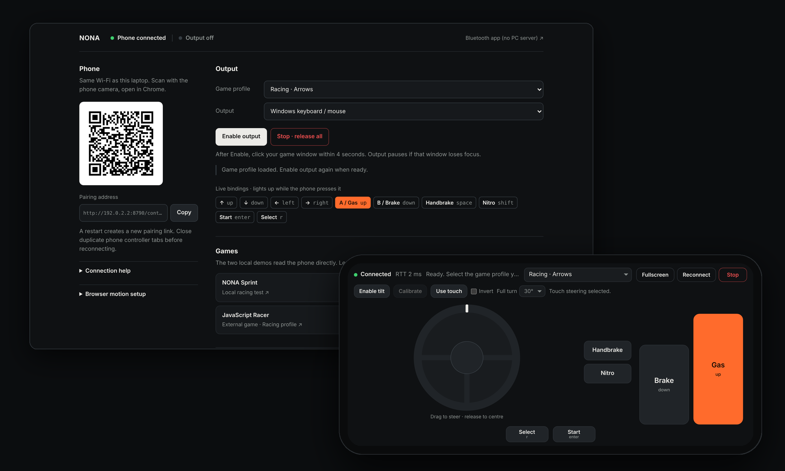
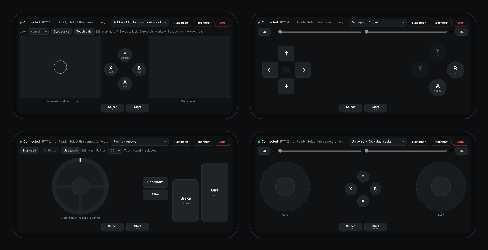
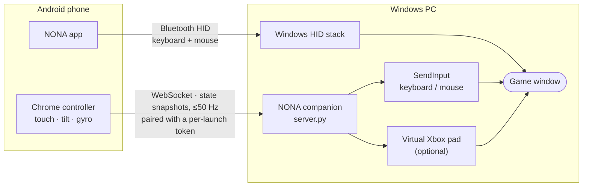

<div align="center">

# NONA

**Your phone is the controller. Your PC runs the game.**

NONA turns an Android phone into a low-latency game controller for Windows: a touch wheel with tilt steering, a dual-stick pad, or a move-and-look surface for third-person games. It connects over Bluetooth with nothing installed on the PC, or over Wi-Fi with a small companion app.

[](https://github.com/garvj65/nona/actions/workflows/ci.yml)
[](https://github.com/garvj65/nona/actions/workflows/android.yml)




<sub>Hold Gas on the phone, and the matching binding lights up on the laptop in the same moment.</sub>

</div>

---

## Choose how to connect

| | **Bluetooth app** | **Wi-Fi browser controller** | **Wi-Fi + virtual Xbox pad** |
|---|---|---|---|
| **Phone** | NONA Android app (APK) | Chrome; nothing to install | Chrome |
| **PC** | Nothing to install | NONA companion (Python) | Companion + optional driver |
| **PC sees** | A Bluetooth keyboard + mouse | Keyboard + mouse input sent to the game window you choose | An Xbox 360 controller with analog sticks and triggers |
| **Best for** | Roblox-style move & look, quick setup | Racing with tilt, custom key maps, the built-in demos | Games that want a real gamepad |
| **Status** | Preview: CI-tested, first device test pending | Tested on a real phone and laptop (racing + tilt) | CI-tested with a mocked driver |
| **Guide** | [Android Bluetooth](docs/ANDROID_BLUETOOTH.md) | [Quick start](#quick-start-wi-fi) | [Xbox output](docs/GAMEPAD_SETUP.md) |

## Quick start: Wi-Fi

You need Windows 10/11, [Python 3.10+](https://www.python.org/downloads/windows/) (tick **Add python.exe to PATH**), and an Android phone on the same Wi-Fi.

1. **Download** this repo (**Code → Download ZIP**) and extract the whole folder.
2. **Run** `START_WINDOWS.bat`. The first launch installs dependencies, and the dashboard opens at `http://localhost:8765`. Allow Python on **Private** networks if Windows Firewall asks.
3. **Scan** the dashboard QR code with your phone and open it in Chrome. Turn the phone sideways.
4. **Play** the built-in **NONA Sprint** racer straight away. For any other game, pick a profile, click **Enable output**, then click the game window within 4 seconds.

> [!TIP]
> Test the key path before a real game. Pick **Racing · WASD**, click **Enable output**, focus Notepad and press **Gas**. You should see `w`.

## Quick start: Bluetooth

1. Download `nona-android-preview` from the latest green [Android preview run](https://github.com/garvj65/nona/actions/workflows/android.yml) and install the APK.
2. Open NONA → **Set up Bluetooth** → **Pair a new computer**.
3. On the PC: **Settings → Bluetooth & devices → Add device → Bluetooth**, pick the phone and confirm the PIN.
4. NONA connects automatically. Tap **Open controller**, focus your game, then tap **Play**.

The full walkthrough, including Vivo battery settings and the acceptance checklist, is in [docs/ANDROID_BLUETOOTH.md](docs/ANDROID_BLUETOOTH.md).

## Controller layouts



| Layout | Controls | Typical use |
|---|---|---|
| **Move & look** | Floating 8-way stick, swipe camera, optional gyro aim, A/B/X/Y | Roblox and third-person games |
| **Gamepad** | D-pad, diamond face buttons, shoulders, Start/Select | Platformers, browser games |
| **Racing** | Touch wheel or calibrated tilt, pedals, handbrake, nitro | NONA Sprint, JavaScript Racer |
| **Dual stick** | Two analog sticks, A/B/X/Y, LB/RB, LT/RT sliders | Virtual Xbox output |

There are **11 built-in profiles**: Gamepad, Racing, Platformer, Celeste Classic, three Roblox variants, Mouse look and two Xbox. You can remap any of them, save it under the game's name, and export or import it as JSON. Read [how profiles work](docs/ADAPTIVE_PROFILES.md).

## What's in the box

**Input**
- **Steering:** proportional touch steering, plus tilt steering with neutral calibration, dead zone and 20/30/45° range.
- **Movement:** an 8-way stick with equal 45° sectors and hysteresis, so an angled thumb still walks straight.
- **Camera:** relative swipe camera with bounded, consume-once deltas. Optional gyro aim is active only while your thumb is on the look area.
- **Bluetooth racing:** the arrow key is pulsed in proportion to how far you steer, so keyboard games get analog-like steering.

**Output**
- **Wi-Fi:** Windows `SendInput` keyboard and mouse, locked to the window you chose.
- **Xbox:** optional virtual Xbox 360 pad with analog sticks and triggers.
- **Bluetooth:** standard keyboard + mouse reports, so Windows needs no driver.

**Safety** (see [Safety by design](#safety-by-design))
- One **Stop** releases everything: keys, buttons, mouse and axes.
- Input stops on timeout, focus change, disconnect, screen lock and profile change.
- Nothing pressed before an interruption is replayed after it.

**Included games**
- **NONA Sprint:** a lap-timed canvas racer with checkpoints, nitro and a pacer car.
- **Neon Run:** a button-response test game.
- **Controller diagnostics:** shows host-side input next to what the operating system detects.

## Project status

Each claim below carries the strongest evidence behind it. [VALIDATION.md](VALIDATION.md) has the full evidence record.

| Capability | Evidence |
|---|---|
| Wi-Fi racing: touch and tilt (NONA Sprint, JavaScript Racer) | **Tested on a real phone and laptop** (Vivo + Windows, Chrome, 10–40 ms controller round trip) |
| Stop / release on Wi-Fi | **Tested on a real phone and laptop** |
| Wi-Fi move & look (Roblox profile) | CI-tested; keyboard-only Roblox play reached, camera path not yet tested on a device |
| Android Bluetooth keyboard + mouse | CI-tested (unit, lint, emulator UI); **first device test pending** |
| Virtual Xbox output | CI-tested with a mocked driver; real game not yet tested |
| Native Wi-Fi app pairing, Windows installer, Play Store release | Designed, not built ([roadmap](docs/ROADMAP.md)) |
| Phone as a PS5 DualSense replacement | Later, separate product ([roadmap](docs/ROADMAP.md)) |

## How it works



Every packet the phone sends is a **full state snapshot** (which buttons are held, plus stick and camera values), not a series of press and release events. If a packet is lost, the next one corrects the state. If packets stop, the companion releases everything within 800 ms. Read [ARCHITECTURE.md](docs/ARCHITECTURE.md) for the full picture and [PROTOCOL.md](docs/PROTOCOL.md) for the wire format.

## Safety by design

A controller that sticks is worse than no controller. NONA treats key release as a core feature:

- **Output is opt-in.** Wi-Fi output starts off, follows a single window you choose, and stops if that window loses focus.
- **The watchdog releases on silence.** No packet for 800 ms means every key, mouse button and axis is released.
- **No replay.** After any interruption, input stays neutral until you press **Play** or **Enable output** again.
- **Pairing is scoped.** The pairing token rotates on every launch, admin routes accept loopback connections only, and the Bluetooth app sends input only to a computer you chose.

Read [SECURITY.md](SECURITY.md) for the threat model and known limits, such as plain HTTP on the local network for the browser path.

## Documentation

| Guide | |
|---|---|
| [Android Bluetooth app](docs/ANDROID_BLUETOOTH.md) | Install, pair and run the device acceptance test |
| [Move & look controls](docs/MOBILE_CONTROLS.md) | Floating stick, swipe camera, gyro aim, Roblox setup |
| [Tilt steering](docs/MOTION_TEST.md) | Trusted local HTTPS, calibration, first tilt test |
| [Xbox output](docs/GAMEPAD_SETUP.md) | Optional virtual Xbox controller and driver status |
| [Game profiles](docs/ADAPTIVE_PROFILES.md) | Presets, remapping, saving and import/export |
| [Compatibility](docs/COMPATIBILITY.md) | Tested games, candidates (Roblox, Celeste, TrackMania) and how to report a result |

| Reference | |
|---|---|
| [Architecture](docs/ARCHITECTURE.md) | Components, transports, input pipeline, design decisions |
| [Protocol](docs/PROTOCOL.md) | WebSocket packets, limits and admin API |
| [Native app pairing](docs/APP_PAIRING.md) | Planned per-device TLS pairing contract |
| [Development](docs/DEVELOPMENT.md) | Run from source, test suites, Android build, CI |
| [Validation](VALIDATION.md) · [Changelog](CHANGELOG.md) · [Roadmap](docs/ROADMAP.md) · [Security](SECURITY.md) | |

## Repository layout

```text
server.py               Companion: pairing, WebSockets, watchdog, profile and output control
windows_input.py        Windows SendInput keyboard/mouse adapter with key ownership tracking
virtual_gamepad.py      Optional virtual Xbox 360 backend (vgamepad / ViGEmBus)
controller_profiles.py  Built-in templates, validation, atomic profile storage
local_tls.py            Optional local HTTPS certificates for browser motion sensors
web/                    Phone controller, laptop dashboard, NONA Sprint, Neon Run, diagnostics
android/                Native Kotlin app: Bluetooth HID link, input session, play surface
tests/                  Python, Node and rendered-browser suites; Android tests live in android/
docs/                   Guides, references and design records
```

## Contributing

Start with [docs/DEVELOPMENT.md](docs/DEVELOPMENT.md). Every change runs the Python, Node, browser and Android suites in CI. A pull request should say what it verified on a real device and what it didn't.
