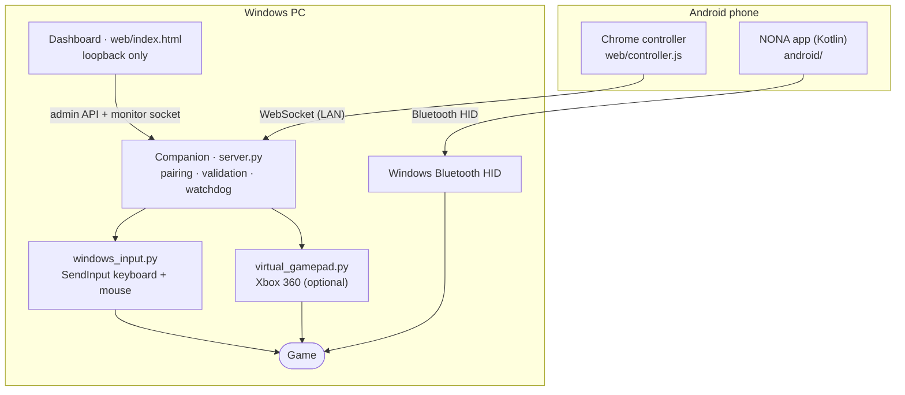
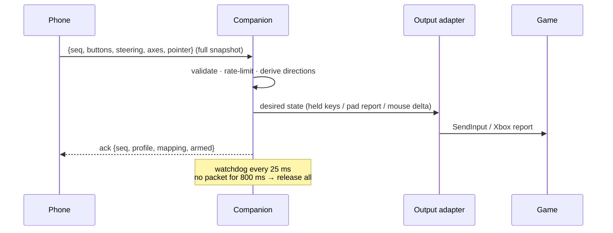

# Architecture

NONA separates **what the player does** (touch, tilt, gyro) from **what the game receives** (keys, mouse, a gamepad). The phone describes its input in a standard form, and an output adapter turns that into whatever the PC needs. Every layer is built so it can fail *neutral*, with nothing left pressed.

## System context

There are two independent paths to the game:

| | Wi-Fi companion | Bluetooth direct |
|---|---|---|
| Phone side | Browser page (no install) | Native app |
| PC side | Python companion | Nothing; Windows' built-in HID driver |
| Output | Keyboard + mouse, or a virtual Xbox pad | Keyboard + mouse |
| Window guard | Yes: output follows the window you armed | No: behaves like a physical keyboard |
| Tilt steering | Yes (needs trusted local HTTPS in the browser) | Not yet (gyro aim in Move & look only) |
| Best at | Racing, custom bindings, analog gamepad | Fast setup, no PC install |

## Components

### Companion (Python, Windows)

| Module | Responsibility |
|---|---|
| `server.py` | Runs the HTTP and WebSocket app (FastAPI on uvicorn, with trusted-host checks). Issues the per-launch pairing token, enforces single-controller ownership, validates packets, maps state to output, and runs the 25 ms watchdog. |
| `controller_profiles.py` | The 11 built-in templates. Validates actions, keys, pad targets, tuning and camera settings, and stores profiles atomically in `%LOCALAPPDATA%\NONA\profiles.json`. |
| `windows_input.py` | Wraps `SendInput`. Tracks which keys NONA owns so shared bindings release only when their last action releases. Moves the mouse relatively and holds the right button. |
| `virtual_gamepad.py` | Optional Xbox 360 target through `vgamepad`. Builds normalized reports, neutralizes on every stop path, and retries rejected neutral reports. |
| `local_tls.py` | Optional local CA and leaf certificate for browser motion sensors. Never installs trust. |
| `run.py` | Launcher: port, profile file, optional TLS. |

### Web clients (plain HTML, CSS and JavaScript, no build step)

| File | Responsibility |
|---|---|
| `web/controller.js` | Phone UI, multi-touch routing, send loop, reconnect and profile sync |
| `web/mobile-input.js` | Floating-stick maths and bounded angular-velocity camera assist |
| `web/motion.js` | Tilt: orientation projection, calibration, dead zone, smoothing, staleness |
| `web/dashboard.js` | Laptop desk: pairing, profiles, mapping editor, arming countdown, live chips |
| `web/race-physics.js` · `web/race.js` | NONA Sprint simulation (pure functions) and canvas renderer |

### Android app (Kotlin, API 28+, no third-party dependencies)

| Class | Responsibility |
|---|---|
| `BluetoothLink` | Registers with Android's HID device service, accepts only a chosen or just-paired computer, reconnects to the remembered one, and sends reports |
| `HidReports` | The HID descriptor: report 1 is an 8-byte boot-style keyboard, report 2 is a 4-byte relative mouse (buttons, dx, dy, wheel) |
| `InputSession` | Turns touches into reports: 8-way stick, pulsed steering, look accumulation, consume-once mouse deltas. Plain JVM code with no Android dependencies, so it can be unit tested. |
| `ControllerSurface` | A single canvas play surface: multi-touch role assignment and drawing |
| `LinkService` | A `connectedDevice` foreground service that keeps the HID registration alive while NONA is off-screen |
| `MainActivity` | Pairing and controller screens, Play/Stop, lifecycle, gyro |

## Input pipeline

1. **Capture.** Touch, tilt and gyro are normalized on the phone: sticks to [-1, 1] with Y positive downward, triggers to [0, 1], camera to bounded relative deltas.
2. **Send.** Continuous changes are coalesced to at most 50 Hz, button edges go immediately, and a heartbeat goes every 100 ms. A button tapped and released between sends still arrives.
3. **Validate.** The companion rejects anything outside the schema and closes the socket (code 1008).
4. **Derive.** Keyboard profiles turn sticks into 8-way directions and steering into left/right with hysteresis. Gamepad profiles keep the analog values, applying dead zone, sensitivity and invert.
5. **Emit.** The selected adapter applies the state difference. Camera deltas are applied once and never replayed by the watchdog.

## Key decisions

| # | Decision | Why |
|---|---|---|
| 1 | **Send full state snapshots, not events** | A lost or reordered packet can't leave a key down: the next snapshot is the truth. A strictly increasing `seq` drops stale frames. |
| 2 | **Output is opt-in and follows one window** | Injected input must never land in the wrong app. Arming needs a laptop action, a 4-second focus capture and loopback-only admin routes. |
| 3 | **Ship direct Bluetooth HID before a Bluetooth data channel** | HID needs no PC install and matches the working keyboard-and-mouse controls. A custom data channel would still need the companion. See [BLUETOOTH_AND_DEPLOYMENT.md](BLUETOOTH_AND_DEPLOYMENT.md). |
| 4 | **Keep the HID registration alive with a foreground service** | Android unregisters a HID app once it's no longer visible (AOSP `HidDeviceService`). A `connectedDevice` service keeps the process important enough to stay registered through a lock or a pairing screen, while input still pauses. |
| 5 | **Equal 45° sectors for 8-way movement** | Per-axis thresholds leaked strafing after about 13° of thumb drift. Sectors with 7.5° hysteresis give every direction the same room and stop flicker at the edges. |
| 6 | **Pulsed steering for keyboard racing** | Keyboard games integrate steering over time while a key is held, so duty-cycling the key over 120 ms gives proportional-feeling steering without a gamepad driver. |
| 7 | **A 20 ms main-thread tick on Android** | A repeating message faster than about 15 ms keeps the UI thread permanently busy (it hung the emulator test) and costs battery for no visible gain. |
| 8 | **No build step on the web side** | Setup stays at "install Python, double-click". Node is needed only for the unit tests. |

## Failure model

| Event | Wi-Fi companion | Bluetooth app |
|---|---|---|
| Stop pressed | Release all, disarm | Empty reports, pause |
| Silence for 800 ms | Release all, disarm | — (the HID connection drops instead) |
| Game window loses focus | Release all, disarm | No guard; it acts as a physical keyboard |
| Phone locks or switches app | Socket closes, then watchdog release | Pause and empty reports; the link stays up for 10 minutes |
| Profile or mapping change | Release all, disarm | Pause |
| Reconnect | Starts neutral and disarmed | Starts neutral and paused; needs Play |

## Security

See [SECURITY.md](../SECURITY.md) for the trust boundaries, input validation limits and known gaps.
