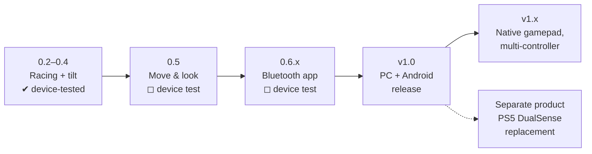

# Roadmap

**North star:** any Android phone becomes a controller good enough to replace a real one: first for PC games, later as a DualSense replacement for a PS5 over Remote Play.

The work moves through gates. A gate passes on **device evidence** recorded in [VALIDATION.md](../VALIDATION.md), not on code merged or CI going green.

## Where we are

## Toward v1.0

| Gate | Goal | Status |
|---|---|---|
| **1. Motion** | Calibrated tilt racing works on a real phone and recovers safely | **Passed** (2026-11-16) |
| **2. Bluetooth works on hardware** | The vivo Y33T registers as a keyboard and mouse, pairs, plays, and releases on every interruption | **Next.** Checklist in [ANDROID_BLUETOOTH.md](ANDROID_BLUETOOTH.md#acceptance-test) |
| **3. A real game** | One Roblox experience is playable with Move & look on both paths, compared with the laptop's own keyboard and mouse | Keyboard-only partial pass; camera path not yet run |
| **4. Refine** | Tune camera speed, stick sectors, steering pulse and gyro from measured results; fix every stuck-input or lifecycle failure | Waiting on gates 2–3 |
| **5. Security review** | Independent review of pairing, origin boundaries, input release, profile import, transport, dependencies and the mobile lifecycle; findings fixed and re-verified | Not started. See [SECURITY.md](../SECURITY.md) for the current model. |
| **6. Package** | A Windows companion that needs no Python install, a signed Android build, and tested install, upgrade and uninstall on real devices | Not started |

**v1.0 ships when all six gates pass.** Until then every build is a preview.

## v1 product scope

- **Android app** with two connection modes:
  - **Direct Bluetooth** (keyboard + mouse, no PC install): built and in device testing.
  - **Wi-Fi companion** with per-device QR pairing and app-scoped TLS: designed in [APP_PAIRING.md](APP_PAIRING.md).
- **Windows companion** as a single installer: window-locked output, saved profiles and optional virtual Xbox output.
- **Profiles that follow the game**: built-in templates, remapping, import and export.

## After v1

| Theme | What | Why it waits |
|---|---|---|
| Bluetooth gamepad | A generic HID gamepad descriptor for analog sticks and triggers over Bluetooth | A generic gamepad isn't XInput: game support varies, so it needs its own compatibility gate |
| Xbox backend | Replace the retired ViGEmBus driver with a maintained backend | Depends on a viable maintained option |
| Multiple controllers | Several phones, each owning its own output | One phone and one host must be solid first |
| Bluetooth data to the companion | Wi-Fi-free companion mode | Only useful once the companion is packaged |
| Haptics and accessibility | Vibration feedback, remappable layouts, left-handed and large-target modes | |
| More platforms | macOS and Linux output adapters | Windows first |

## Separate product: phone as a DualSense for PS5

After the PC version is stable, explore a separate bridge so a phone can stand in for the controller in PS5 Remote Play, on a console the player owns with a legitimate account. The phone replaces the controller, and the real PS5 still runs the game. This is not console emulation, and it gets its own feasibility, latency and compatibility gates. Success on Windows says nothing about whether a PS5 will accept it.

## Released

See [CHANGELOG.md](../CHANGELOG.md): 0.1 (first release) → 0.2 racing → 0.3 profiles and Xbox → 0.4 tilt → 0.5 Move & look → 0.6 Bluetooth app → 0.6.1 lifecycle, 8-way movement and redesign.
